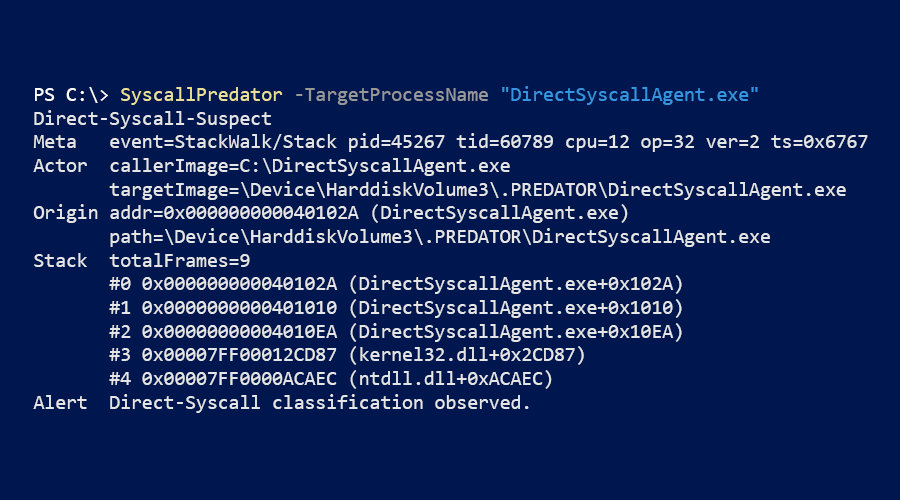

# SyscallPredator

SyscallPredator is a method of detecting direct syscalls.
It consists of 2 components that assist with the monitoring of processes and stack analysis.
The first component will track any new processes started via `ProcessStart` events, and any images that the process subsequently loads via `ImageLoad` events.
The second component analyzes `StackWalk/Stack` events and determines whether the `SysExit` returns to untrusted user space memory.

**Disclaimer**: The purpose of this is for educational purposes and testing only.
Do not use this on machines you do not have permission to use.
Do not use this to leverage and communicate with machines that you do not have authorization to use.

## Preamble.

Direct syscalls are a method of performing syscalls in an attempt to bypass **Endpoint Detection & Response** (EDR).
EDRs will hook into `ntdll.dll` to inspect elements before syscalls.
To avoid detection from the userland hooks, a direct syscall can be used.
If the appropriate System Service Number (SSN) is known, any syscall endpoint can be reached by executing a `syscall` instruction.
This means a `syscall` can be executed outside of a syscall stub, getting the desired effect.

**Event Tracing for Windows** (ETW) may be used to detect this behavior.
If appropriate kernel events are enabled inside a tracing session, a callback can be reached to provide analysis for that event.
Analyzing this event can dictate the `syscall` execution origin.

## How it works.

The first component monitors processes and the images loaded into each process.
If the correct kernel provider is enabled in a tracing session, the kernel will emit information pertaining to both.
The `ProcessStart` event comes with the associated process name and ID.
The `ImageLoad` event comes with the loaded image's file path, base address, and size.

The other event needed is `StackWalk/Stack` on `SysExit`.
This event will come with return addresses determined by stack frames.
By inspecting individual instruction pointers, we compare them against loaded images memory.
Ultimately, if this memory lies outside of a trusted/untampered module, this is reported.

## Observation.

In the scenario that stack capture is enabled for `SysEnter` events, the stack provides context about the thread from creation.
If the example thread's stack was captured at thread creation, we can follow the call chain up until the exact Windows API function was called.
This only occurs if an appropriate route for syscalling was used.
Even if the exact syscall stub was called (for maximum control), it would be evident in the stack capture.

```
→ ntdll!RtlUserThreadStart
→ kernel32!BaseThreadInitThunk
→ example.exe!0x00000000004010EA
→ ntdll!ZwCreateThreadEx
---------------------------------
→ ntoskrnl!PsCreateSystemThreadEx
```

The useful address is the first userland frame in the captured stack.
If the first user space address lies within the originating process' image, this evidence is used to determine a direct syscall has taken place.

```
→ ntdll!RtlUserThreadStart
→ kernel32!BaseThreadInitThunk
→ example.exe!0x00000000004010EA ← No API call before kernel mode transition.
---------------------------------
→ ntoskrnl!PsCreateSystemThreadEx
```

## Example.

<div align="center" markdown="1">
        <sup>DirectSyscallAgent.exe test.</sup>
        </br>
         
</div>

## Building it out.

###### Follow with `SyscallPredator.ps1`

The script uses the [PowerShell 7+](<https://learn.microsoft.com/en-us/powershell/scripting/install/install-powershell-on-windows>) and the [TraceEvent](<https://www.nuget.org/packages/Microsoft.Diagnostics.Tracing.TraceEvent/>) assembly to create an ETW session.
The kernel providers enabled are `ProcessStart`, `ImageLoad`, and `StackWalk/Stack` for `SysExit` events.
For the organizational piece, I referenced loaded image hashmaps in order to each process.

```PowerShell
#
# Organize processes
#
$ProcessList = @{ 
        0 = @(@{
        NtImageFilePath  = "",
        ImageFilePath    = "",
        ImageFileName    = "",
        ImageBaseAddress = 0,
        ImageSize        = 0
        },
        ...
)}

#
# StackWalk analysis
#
function StackWalkCallback {
        param ($Event)

        if (-not $ProcessList.ContainsKey($Event.ProcessID)) {
                return
        }
        for ($i = 0; $i -lt $Event.FrameCount; $i++) {
                if ($Event.InstructionPointer($i) -gt 0x7FFFFFFFFFFF) {
                        continue
                }
                if (-not ($Event.InstructionPointer($i) -in $Trusted)) {
                        ReportEvent $Event
                }
                break
        }
}
```